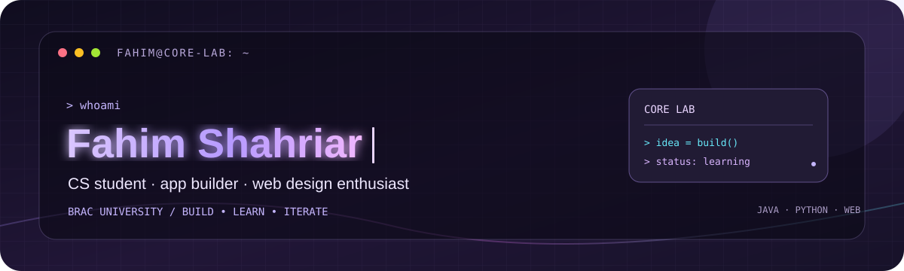

### Computer Science student · App builder · Web design enthusiast

**Studying Computer Science at BRAC University**

[⬇️ Download DailyDone APK](https://github.com/fahimshahriar-cs/DailyDone/raw/refs/heads/main/dailydone.apk) · [Explore the project](https://github.com/fahimshahriar-cs/DailyDone)

---

## ✦ About me

I’m an aspiring developer who enjoys turning ideas into useful apps and clean, easy-to-use websites. I’m building my foundations in programming and software development through coursework and hands-on projects. **DailyDone is my first app project.**

- 🎓 Computer Science student at **BRAC University**
- 📱 Interested in **app creation** and practical mobile experiences
- 🌐 Interested in **website design** and front-end development
- 🌱 Learning by building, practicing fundamentals, and sharing progress
- 📍 Bangladesh

## 🧬 ExploByte

**ExploByte is my personal network lab for ideas, experiments, and projects in progress.**

🟣 **IDEA** &nbsp; → &nbsp; 🔵 **PROTOTYPE** &nbsp; → &nbsp; 🟢 **LEARN** &nbsp; → &nbsp; 🟠 **ITERATE**

The animated network panel above is built as SVG code: signal pulses move between nodes while the ExploByte label and status lines animate. It reflects how I like to work: explore a concept, build something small, learn from it, and improve it.

## 💻 Languages & web

     

## 🖥️ Systems I use and explore

   

## 🎨 Creative tools

    

## ✦ Featured project

### 📱 DailyDone — my first app

A simple, offline-ready task manager for Android, built to help people organize everyday tasks and track their progress. It’s an early personal project and is shared as a direct APK download.

[⬇️ Download the Android APK](https://github.com/fahimshahriar-cs/DailyDone/raw/refs/heads/main/dailydone.apk) · [View DailyDone on GitHub](https://github.com/fahimshahriar-cs/DailyDone)

> DailyDone is an early, simple offline app shared as a direct APK download. It is not a release build.

## 🌱 Current focus

- Strengthening programming fundamentals with Java, Python, C, and C++
- Practicing problem-solving and data structures
- Learning more about building apps and designing websites
- Exploring creative tools for digital design and media

---

*Thanks for visiting — learning, building, and improving one project at a time.*

