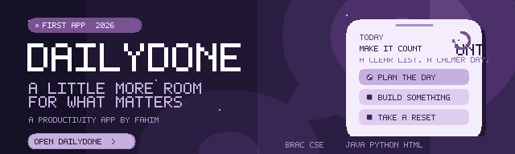

# Fahim Shahriar

### CS Student @ BRAC University · Aspiring Software Developer

Learning by building, practicing the fundamentals, and sharing progress along the way.

---

## ✦ About

I’m an aspiring developer focused on building a strong foundation in programming and software development. I’m studying **Computer Science at BRAC University** and enjoy turning ideas into useful apps and clean, easy-to-use websites. I value thoughtful problem-solving, steady progress, and learning through practical work.

- 🎓 Studying **Computer Science at BRAC University**
- 🌱 Learning **Java**, **Python**, **HTML**, and the fundamentals of app development
- 🎨 Interested in **app creation**, **website design**, and thoughtful user experiences
- 🔎 Interested in **open source** and how software is built collaboratively
- 📍 Based in **Bangladesh**

## ✦ Featured Project

### 📱 DailyDone — my first app

A simple, offline-ready task manager for Android, built to help people organize everyday tasks and track their progress. This is an early personal project and is shared as a direct APK download.

  

<a href="https://github.com/fahimshahriar-cs/DailyDone/raw/refs/heads/main/dailydone.apk"><strong>⬇️ Download DailyDone for Android</strong></a> · <a href="https://github.com/fahimshahriar-cs/DailyDone">View the project</a>

## ✦ Current Focus

- Strengthening programming fundamentals with **Java** and **Python**
- Practicing data structures and problem-solving
- Learning the core tools and concepts behind **web development and app creation**
- Exploring clean, accessible **website design**

---

*Thanks for visiting my profile — I’m learning, building, and improving one step at a time.*

